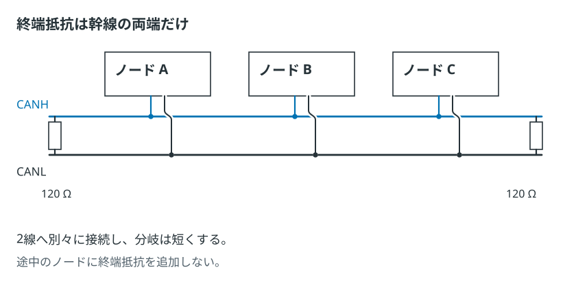
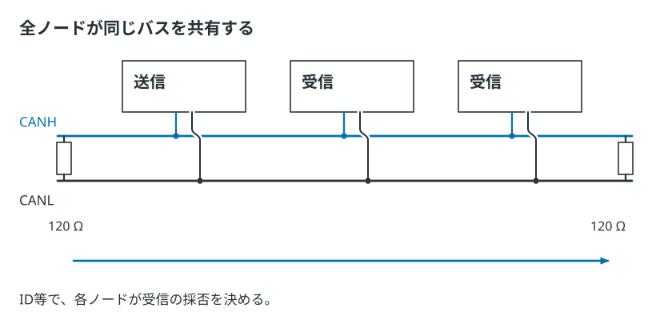

---
tags:
    - 開発資料
    - 有線通信
    - CAN
    - CAN FD
    - 入門
---

# CAN / CAN FD入門 第1編
## 2本の通信線を複数の機器で共有する

複数のマイコンに同じセンサーの値を届けるには、どうすればよいでしょうか。

UARTだけで構成しようとすると、送信相手ごとに配線やポートが必要になります。機器が増えるほど線も増え、誰が誰へ送るのかという管理も複雑になります。

CANでは、CAN_HとCAN_Lの2本を複数のノードで共有します。送信したメッセージはバス全体に流れます。

<picture><source media="(max-width: 600px)" srcset="./images/Wired_Communication/can-bus-connection-mobile.svg"></picture>

ここでいう**ノード**は、CANバスにつながる機器のことです。ECUやマイコン基板のほか、センサーやアクチュエーターもノードになります。

## CANは「相手」ではなく「情報」にIDを付ける

CANのIDは、送り先の機器番号ではありません。メッセージの内容にIDを割り当てます。

例えば、次のように使います。

| CAN ID | メッセージの意味 | 使用するノード |
|---|---|---|
| `0x100` | モーター回転数 | 表示器、制御ECU |
| `0x180` | バッテリー電圧 | 制御ECU、ロガー |
| `0x300` | 温度 | ファン制御、表示器 |

送信ノードはIDとデータをまとめてバスへ送ります。フレームはすべてのノードに届きます。受信フィルターやソフトウェアが、そのフレームを使うかどうか決めます。

この方式は**メッセージ指向**、または**内容指向アドレッシング**と呼ばれます。

同じメッセージを複数のノードで使えるので、送り先ごとに配線を増やさずに済みます。

<picture><source media="(max-width: 600px)" srcset="./images/Wired_Communication/can-message-broadcast-mobile.svg"></picture>

## すべてのノードが送信を開始できる

CANには固定されたマスターがありません。バスが空いていれば、どのノードからでも送信できます。

これは**マルチマスター方式**です。

2台以上が同時に送信を始めることもあります。その場合、CANはIDを1ビットずつ比べ、優先度の高いフレームの送信を続けます。

優先度の低いノードは送信を止め、バスが空いてから送り直します。送信中のフレームを両方とも破棄するわけではありません。この仕組みを**非破壊ビット単位調停**と呼びます。

## マイコンだけではCANバスへ接続できない

「CAN対応マイコン」でも、CAN_HとCAN_Lへそのままつなげるとは限りません。

CAN通信では、主に次の2つの回路が働きます。

- **CANコントローラ**：ID、フレーム、CRC、調停、ACK、エラー処理を扱う
- **CANトランシーバ**：マイコン側のTX/RX信号をCAN_H/CAN_Lの電気信号へ変換する

<picture><source media="(max-width: 600px)" srcset="./images/Wired_Communication/can-controller-vs-transceiver-mobile.svg"></picture>

CANコントローラは通信のルールを扱い、トランシーバは配線上の信号を送受信します。STM32など、CANコントローラを内蔵したマイコンでも、通常はCANトランシーバを外付けします。

## CANが得意なこと

CANは、例えば次のような用途に向いています。

- 複数ノードが同じ情報を利用する
- 重要な情報を優先して送る
- ノイズのある環境で通信する
- 通信異常をハードウェアで検出する
- ノードを追加しても基本配線を大きく変えない

一方、CAN IDだけでは「どのバイトが温度か」「単位は何か」「送信周期はいくつか」までは決まりません。これらはシステム設計者が通信仕様として定義します。

CANが決めるのは通信の土台です。データの意味や形式は、システムごとに定義します。

2本の線でノイズに強い通信ができる理由は、CAN_HとCAN_Lの「電圧差」にあります。
