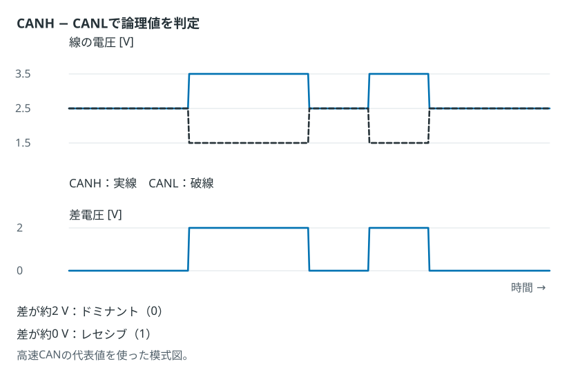
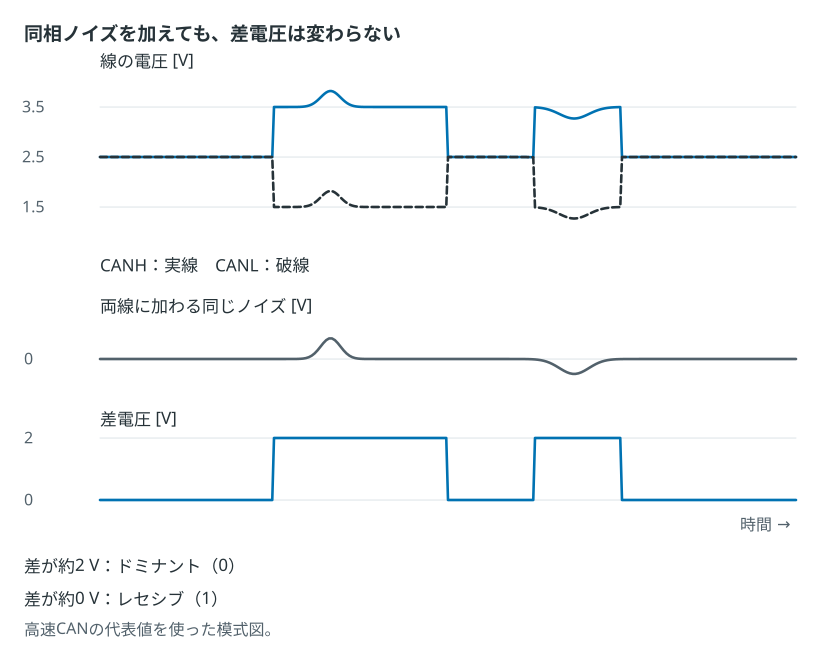
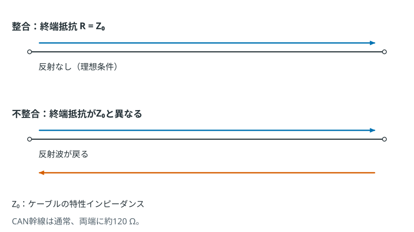

---
tags:
  - 開発資料
  - 有線通信
  - CAN
  - CAN FD
---

# CAN / CAN FD入門 第2編
## CAN_HとCAN_L、差動信号と配線

CANの信号は、1本の線の電圧だけを見て決めるわけではありません。

CAN_HとCAN_Lの**電圧差**で判定します。外からのノイズが2本にほぼ同じように加われば、電圧差は変わりにくくなります。

<picture><source media="(max-width: 600px)" srcset="./images/Wired_Communication/can-differential-signal-mobile.svg"></picture>

## ドミナントとレセシブ

CANでは論理値をHigh／Lowとは呼ばず、次のように表します。

| 論理値 | CANでの名称 | バスの状態 |
|---|---|---|
| 0 | ドミナント | CAN_HとCAN_Lの差が大きい |
| 1 | レセシブ | CAN_HとCAN_Lの差が小さい |

代表的なHigh-speed CANでは、レセシブ時にCAN_HとCAN_Lはどちらも約2.5 Vです。ドミナント時にはCAN_Hが上がり、CAN_Lが下がります。受信側は個々の電圧ではなく、主に2本の差を見ます。

電圧範囲はトランシーバや規格条件によって変わります。測定値が代表値と少し違っていても、それだけで故障とは判断できません。

## なぜドミナントが優先されるのか

複数のノードが同時に送信すると、一方がレセシブ、もう一方がドミナントを送ることがあります。このときバス上ではドミナントになります。

この動作は、I2Cのオープンドレインに似ています。各ノードは自分が送った値とバスの状態を比べながら、送信の調停を行います。

レセシブを送ったのにバスがドミナントなら、自分より優先度の高い送信があると分かります。

## 同じノイズが乗っても差は変わりにくい

例えばCAN_HとCAN_Lの両方へ、一瞬だけ+1 Vのノイズが乗ったとします。

それぞれの電圧は変化します。それでも、2本がほぼ同じ量だけ変化すれば、

`CAN_H − CAN_L`

の差は大きく変わりません。

<picture><source media="(max-width: 600px)" srcset="./images/Wired_Communication/differential-noise-immunity-mobile.svg"></picture>

この効果を得るには、2本の線を似た経路に通す必要があります。そこでCAN_HとCAN_Lには、一般にツイストペア線を使います。

## 配線は「幹線」と「短い支線」で考える

High-speed CANは、幹線の両端に終端抵抗を置き、各ノードを短い支線でつなぐのが基本です。

支線が長かったり、分岐が多かったり、スター状に配線したりすると、反射や波形の乱れが起きやすくなります。通信速度が高いほど影響が出やすくなります。

配線を考えるときは、ノード数のほかにも次の点を確認します。

- 幹線の全長
- 支線の長さ
- ケーブルの特性インピーダンス
- コネクタや基板配線
- ビットレート
- サンプルポイント

これらの条件が組み合わさって伝送路の状態が決まります。

## 終端抵抗は各ノードに付けるものではない

一般的なHigh-speed CANでは、バスの物理的な両端に120 Ωの抵抗を1本ずつ接続します。

<picture><source media="(max-width: 600px)" srcset="./images/Wired_Communication/can-termination-reflection-check-mobile.svg"></picture>

電源を切り、CAN_HとCAN_Lの間の抵抗を測ります。120 Ωの抵抗2本が並列につながっていれば、正常な構成では約60 Ωになります。

| 測定値の目安 | 考えられる状態 |
|---|---|
| 約60 Ω | 120 Ωの終端が2本 |
| 約120 Ω | 終端が1本だけ |
| 非常に大きい | 終端なし、または断線 |
| 60 Ωより小さい | 終端が多すぎる可能性 |

抵抗を測るときは、必ずバスの電源を切ってください。

## GNDは不要なのか

CANは差動信号を使いますが、接続機器間の基準電位差に制限がないわけではありません。トランシーバにはCAN_HとCAN_Lを扱える電圧範囲（同相電圧範囲）があり、範囲を外れると正常に受信できない可能性があります。

同じ装置内や非絶縁の構成では、CAN_H、CAN_Lに加え、信号の基準となるGNDも配線するのが一般的です。絶縁CANでは、絶縁電源やシールド、接地方法も含めて設計します。

差動信号だからといって、GNDが必ず不要になるわけではありません。

