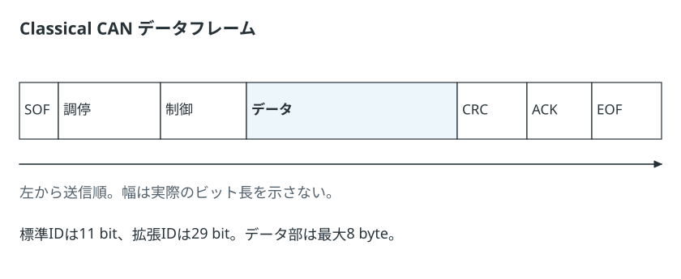

---
tags:
    - 開発資料
    - 有線通信
    - CAN
    - CAN FD
    - CANフレーム
    - CRC
---

# CAN / CAN FD入門 第3編
## CANフレームの構成

オシロスコープでCANバスを見ると、0と1が続いているように見えます。

CANコントローラは、そのビット列を開始、ID、データ、検査、応答、終了の領域に分けて処理します。このひとまとまりを**CANフレーム**と呼びます。

<picture><source media="(max-width: 600px)" srcset="./images/Wired_Communication/classical-can-frame-mobile.svg"></picture>

## データフレームの主な領域

まずはデータフレームを見ていきます。

| 領域 | 主な役割 |
|---|---|
| SOF | フレーム開始と同期 |
| Arbitration | IDとRTR。優先順位の判定に使用 |
| Control | フォーマット情報とDLC |
| Data | 実際に送りたいデータ |
| CRC | フレーム破損の検出 |
| ACK | 正常受信できたノードが応答 |
| EOF | フレーム終了 |

まず、IDは「何のデータか」、DLCは「何バイトか」、Dataは「値そのもの」を表すと考えてください。CRCとACKは、フレームが正しく届いたかに関係します。

## 標準IDと拡張ID

Classical CANのIDには、次の2つの形式があります。

- 標準フォーマット：11 bit ID
- 拡張フォーマット：29 bit ID

11 bit IDでは`0x000`から`0x7FF`までを使用できます。29 bit IDはさらに多くの識別子を持てますが、ID領域が長くなるため、同じデータ量でもバス占有時間は増えます。

IDは長ければよいわけではありません。使う上位プロトコルや既存ネットワーク、必要なメッセージ数に合わせて選びます。

## DLCとデータフィールド

DLCはData Length Codeの略です。データフィールドの長さを表します。

Classical CANのデータ長は0～8 byteです。例えばDLCが4なら、データフィールドは4 byteです。

ただし、4 byteの中身の意味はCAN規格だけでは決まりません。

例えば、モーター回転数に2 byte、温度に1 byte、状態フラグに1 byteを割り当てるとします。その場合はバイト順や符号、倍率、無効値も通信仕様書に記載します。

## CRCは内容の破損を検出する

送信ノードはフレームの内容からCRCを計算して送ります。受信ノードも受け取った内容からCRCを計算し、フレーム内のCRCと比べます。

値が一致しなければ、通信中にビットが変化した可能性があります。

CRCでは、データの意味が正しいかまでは確認できません。例えば温度センサーが故障し、形式としては正しい異常値を送った場合、CRCは正常になります。

通信エラーとセンサー異常は、別々に考える必要があります。

## ACKは「全員が受信した」という意味ではない

送信ノードはACKスロットでレセシブを送ります。フレームを正常に受信したノードは、このスロットでドミナントを送ります。

送信側がドミナントを確認できれば、少なくとも1つのノードがフレームを正常に受信したと分かります。

ACKだけでは、目的のノードやすべてのノードが受信したか、アプリケーションがデータを使ったかまでは分かりません。確認が必要なら、上位プロトコルで応答メッセージやタイムアウトを設計します。

## 同じビットが続きすぎないようにする

CANはNRZ方式を使います。同じ値が長く続くと信号が変化せず、各ノードが通信タイミングを補正しにくくなります。

そのため、同じ論理値が5 bit続くと、送信側は反対の値を持つ**スタッフビット**を1 bit挿入します。受信側は同じ規則で取り除きます。

<picture><source media="(max-width: 600px)" srcset="./images/Wired_Communication/can-bit-stuffing-mobile.svg"></picture>

スタッフビットはデータそのものではありませんが、バス上では送信されます。その分、フレーム時間やバス負荷に影響します。

