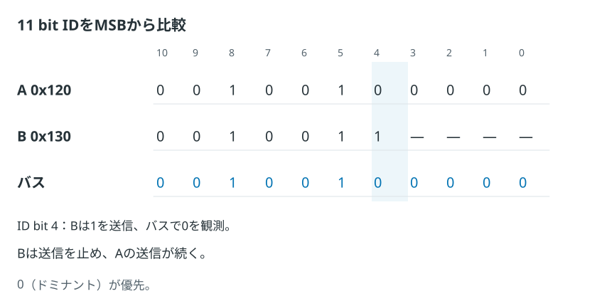
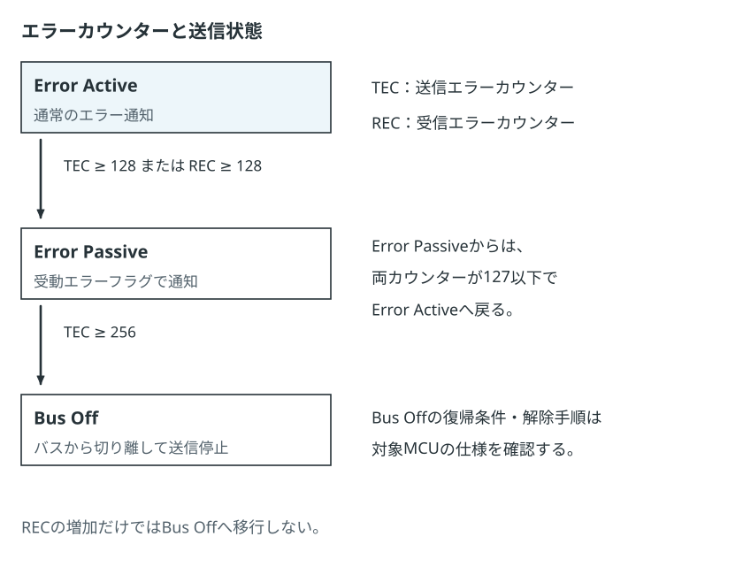

---
tags:
    - 開発資料
    - 有線通信
    - CAN
    - CAN FD
---

# CAN / CAN FD入門 第4編
## 同時送信と通信エラーをCANはどう処理するか

CANでは、複数のノードが同時に送信を始めることがあります。普通なら信号がぶつかって通信が壊れそうですが、CANでは送信中にどのフレームを先に流すか決めています。

## 小さいIDほど優先される理由

CAN IDは上位ビットから順に送られます。0はドミナント、1はレセシブです。各ノードは、自分が送った値とバス上の値を見比べます。

- 自分が0を送り、バスも0：送信継続
- 自分が1を送り、バスも1：送信継続
- 自分が1を送ったのにバスが0：調停に負けて送信停止

この比較で先にドミナントが現れる、つまり数値の小さいIDが優先されます。

<picture><source media="(max-width: 600px)" srcset="./images/Wired_Communication/can-arbitration-retransmission-mobile.svg"></picture>

調停に負けてもエラーにはなりません。そのノードは受信に回り、送信を続けたノードのフレームを受け取ります。バスが空けば、あらためて送信を試みます。フレームを壊さずに順番を決めるので、これを**非破壊調停**と呼びます。

## 優先度を上げすぎると別の問題が起きる

重要なメッセージに小さいIDを割り当てると、送信権を得やすくなります。ただし、高優先度フレームが頻繁に流れてバス負荷が高いと、低優先度フレームは長く待たされることがあります。IDを決めるときは重要度だけでなく、送信周期や許容遅延、データ長も見ておきます。

## CANが検出する主なエラー

CANコントローラは、通信中に複数の観点でフレームを監視します。

| エラー | 検出内容 |
|---|---|
| Bit error | 送信値とバス上の値が一致しない |
| Stuff error | ビットスタッフィング規則に違反 |
| CRC error | 受信側のCRC計算結果が一致しない |
| Form error | 固定形式のビットが規定値と異なる |
| ACK error | ACKスロットがレセシブのまま |

調停中にレセシブを送ってドミナントを読んだ場合や、ACKスロットで受信ノードがドミナントを返す場合など、正常動作として不一致が起きる場所はBit errorの対象外です。

## エラーが起きたフレームは全員で捨てる

ノードがエラーを検出すると、エラーフラグを送ってフレームを中断します。他のノードもそのフレームを異常と判断して破棄します。送信ノードは通常、バスが空いたあとに再送します。受信側によって異なる内容が届くのを防ぐ仕組みです。

ただし、自動再送を無効化できるCANコントローラもあります。再送の有無は、使用するマイコンの設定とシステム要求を確認します。

## 故障ノードがバスを止め続けない仕組み

故障したノードがエラーフラグを出し続ければ、ほかのノードも通信できなくなります。そこでCANコントローラは送信・受信それぞれのエラーカウンターを持ち、エラーが重なると状態を変えます。

<picture><source media="(max-width: 600px)" srcset="./images/Wired_Communication/can-error-state-flow-mobile.svg"></picture>

- **Error Active**：通常状態。アクティブエラーフラグを送れる
- **Error Passive**：エラーが多い状態。バスへの影響を抑える
- **Bus Off**：重大な送信異常。バスへの送信から切り離される

Bus Offからどう復帰するかは、コントローラやソフトウェアの設計によります。自動で復帰させるか、時間を置くか、電源再投入や診断を求めるか、あらかじめ決めておきます。

## ACKエラーが続くとき

ノードを1台だけつないで送信すると、波形は出ているのに送信完了にならないことがあります。受信ノードがいないのでACKが返らず、送信側はACK errorとして扱います。設定によっては同じフレームを繰り返し送ります。トランシーバの故障とは限りません。

- 相手ノードが接続されているか
- 相手とビットレートが一致しているか
- 相手がListen-onlyになっていないか
- CAN_H/CAN_Lが逆でないか
- 終端抵抗が正しいか

まずはACKを返せる相手がいるか、相手の設定が合っているかを確かめます。

