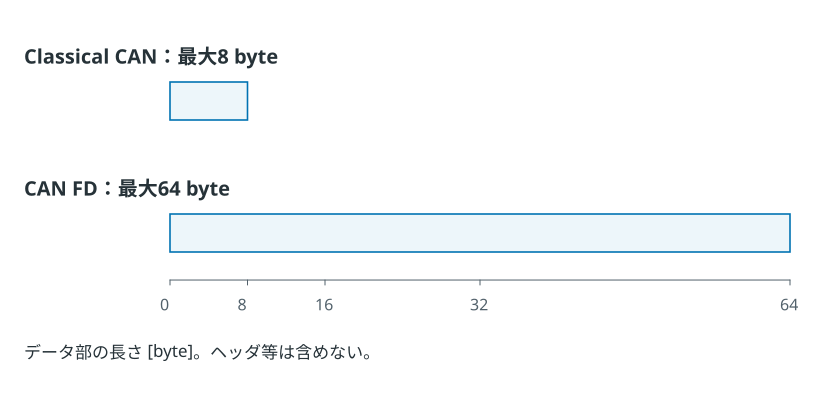

---
tags:
    - 開発資料
    - 有線通信
    - CAN FD
    - CAN
---

# CAN / CAN FD入門 第5編
## CAN FDは何を変え、何を残したのか

Classical CANでは、1フレームに最大8 byteまでしか載せられません。ソフトウェア更新や診断データのように大きなデータを送ると、何度もフレームに分けることになります。分割すれば、その分IDやCRC、ACKなどの領域も必要です。

CAN FDは、CANの調停やエラー処理を引き継ぎつつ、1フレームのデータ量を増やし、データ部を速く送れるようにした規格です。

## Classical CANとCAN FD

<picture><source media="(max-width: 600px)" srcset="./images/Wired_Communication/can-vs-canfd-frame-mobile.svg"></picture>

| 項目 | Classical CAN | CAN FD |
|---|---|---|
| 1フレームのデータ長 | 0～8 byte | 0～64 byte |
| ビットレート | フレーム内で基本的に一定 | データ部を高速化可能 |
| リモートフレーム | あり | FD形式ではなし |
| CRC | Classical CAN用 | データ長に応じて強化 |
| ID | 11 bit / 29 bit | 11 bit / 29 bit |

CAN FDにしたからといって、必ず通信速度が上がるわけではありません。64 byteまで載せられることと、データフェーズを高速化することは別です。BRSを使わず、ビットレートを切り替えないフレームも送れます。

## 一つのフレーム内に2種類の速さがある

CAN FDでは、フレーム前半の調停部分を**アービトレーションフェーズ**、主にデータを送る部分を**データフェーズ**と呼びます。

- アービトレーションフェーズ：すべてのノードが調停できる公称ビットレート
- データフェーズ：必要に応じて高速なデータビットレート

BRS（Bit Rate Switch）が有効な場合、BRS付近からCRC領域の終わり付近まで高速側へ切り替わります。その後、ACKとフレーム終端は公称ビットレートへ戻ります。

調停中は全ノードが同じバス上で送信権を比べるため、この部分は公称ビットレートのままです。

## CAN FDで追加された主なビット

| ビット | 意味 |
|---|---|
| FDF | Classical CANフレームかCAN FDフレームかを識別 |
| BRS | データフェーズでビットレートを切り替えるか |
| ESI | 送信ノードがError ActiveかError Passiveかを示す |

名前は似ていますが、FDFはフレーム形式、BRSは速度切替、ESIは送信ノードのエラー状態を表すビットです。

## DLCとデータ長は途中から一致しない

CAN FDのDLCは4 bitのままです。8 byteを超えるデータ長は、DLCの値に直接バイト数を入れず、規定された長さを表すコードとして扱います。

| DLC | データ長 |
|---:|---:|
| 0～8 | 0～8 byte |
| 9 | 12 byte |
| 10 | 16 byte |
| 11 | 20 byte |
| 12 | 24 byte |
| 13 | 32 byte |
| 14 | 48 byte |
| 15 | 64 byte |

例えば10 byteだけ送りたい場合でも、CAN FDフレームのデータ長としては12 byteを選び、未使用部分の扱いを設計します。

## CRCも長くなる

データ領域が大きくなった分、破損を検出する仕組みも強化されています。CAN FDではデータ長に応じて17 bitまたは21 bitのCRCを使い、スタッフビット数の情報も検査に利用します。CRCの多項式まで覚えなくても構いませんが、Classical CANのデータ部分をそのまま延長しただけではありません。

## Classical CANノードとの混在

CAN FD対応コントローラは、通常Classical CANフレームも扱えます。

しかしClassical CANだけに対応したノードは、CAN FDフレームを正常なフレームとして解釈できず、エラーフレームを送る場合があります。

同じバスに両方のノードを接続できても、すぐにCAN FD通信を始められるとは限りません。次の点を確認します。

- 全ノードがCAN FDに対応しているか
- Classical CANフレームだけを使う期間があるか
- 非対応ノードをSilent状態にできるか
- トランシーバが使いたいデータビットレートに対応しているか

## 高速化すると配線条件は厳しくなる

データビットレートを上げると、支線、コネクタ、基板配線、トランシーバ遅延、リンギングの影響が大きくなります。

CANで問題なく動いた配線でも、CAN FDで同じように動くとは限りません。対応トランシーバを選んだうえで、実際の配線で波形を見て、サンプルポイントに余裕があるか確認します。

