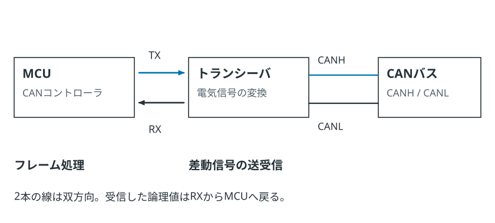

---
tags:
    - 開発資料
    - 有線通信
    - CAN
    - CAN FD
---

# CAN / CAN FD入門 第6編
## 回路設計から通信確認までの実践手順

CANが動かないとき、どこから調べればよいでしょうか。ソフトウェアの設定だけでなく、ビットレートやピン、トランシーバ、終端抵抗など、原因はいくつも考えられます。まずは確認する順番を決めて、一つずつ切り分けます。

## 1. 要求を先に固定する

回路やコードを書く前に、少なくとも次を決めます。

- Classical CANかCAN FDか
- 標準IDか拡張IDか
- 公称ビットレート
- CAN FDでBRSを使うか
- データビットレート
- 最大バス長と支線長
- ノード数
- 絶縁の要否
- メッセージ周期と許容遅延

CAN FDというだけでは通信条件は決まりません。公称ビットレートとデータビットレートをそれぞれ決めます。

## 2. ハードウェア構成を確認する

信号は、マイコンのCANコントローラからトランシーバを通ってバスへ出ます。

`アプリケーション → CANコントローラ → CANトランシーバ → CAN_H / CAN_L`

<picture><source media="(max-width: 600px)" srcset="./images/Wired_Communication/can-controller-vs-transceiver-mobile.svg"></picture>

まず、次の配線や設定を確認します。

- マイコンのCAN TX/RXピンが正しい
- トランシーバのTXD/RXD方向が正しい
- Standby、Enable、Silent端子が動作状態になっている
- トランシーバの電源電圧とI/O電圧が適合している
- CAN FDでは目標データビットレート対応品を選んでいる
- 必要に応じてGNDまたは絶縁回路を接続している

トランシーバのStandby端子が固定されていないため、受信だけできない、送信だけできないという故障に見える場合があります。

## 3. 電源OFFで配線を確認する

電源を切った状態で、まずCAN_HとCAN_Lの間の抵抗を測ります。

CAN_HとCAN_L間が約60 Ωなら、120 Ωの終端が2本ある目安になります。約120 Ωなら片側不足、60 Ωより小さければ終端過多を疑います。

続けて、配線の導通を確認します。

- CAN_Hが各ノードのCAN_Hへつながっている
- CAN_Lが各ノードのCAN_Lへつながっている
- CAN_HとCAN_Lが短絡していない
- GND基準が必要な範囲にある

ここで終端抵抗の不足や過多、CAN_HとCAN_Lの短絡が見つかることがあります。

## 4. まず2ノードで動かす

いきなり多数のノードをつなぐと、問題が起きたときに原因を追いにくくなります。まずは送信側と受信側の2台を、短い幹線と正しい終端でつないで試します。

送信側だけの1ノード構成ではACKが返らず、再送が続く場合があります。波形が出ていることと、送信が正常完了したことは別です。

## 5. コントローラ設定を合わせる

両方のノードで、次の設定を合わせます。

- 公称ビットレート
- サンプルポイント
- SJWとタイムセグメント
- Classical CAN / CAN FD
- BRSの使用有無
- データビットレート
- 標準ID / 拡張IDの扱い

設定画面に「500 kbit/s」と表示されていても、クロック源や分周値が違えばビット時間は合いません。マイコンのCANカーネルクロックから設定値を確認します。

## 6. フィルターを一度広げる

物理層とフレームが正常でも、受信フィルターがIDを拒否しているとソフトウェアには届きません。

立ち上げ時は、可能なら一度すべてのIDを受信する設定にします。通信できることを確認してから、必要なIDだけに絞ると、フィルターと配線を切り分けやすくなります。

## 7. ロジックだけでなくバスを見る

CAN TXピンの信号だけでは、トランシーバの先にあるバスの状態までは分かりません。オシロスコープでCAN_HとCAN_Lを見て、次の点を確認します。

- CAN_HとCAN_Lが両方変化している
- ドミナント時に差動電圧が生じている
- 反射や大きなリンギングがない
- ACK位置にドミナントがある
- CAN FDではBRS後にビット幅が短くなる

差動プローブがない場合は、CAN_HとCAN_LをそれぞれGND基準で測り、演算機能で差を表示する方法もあります。プローブのGND接続方法には十分注意します。

## 症状から原因を絞る

| 症状 | 最初に確認すること |
|---|---|
| 波形がまったく出ない | ピン設定、クロック、トランシーバEnable |
| TXは動くがCAN_H/Lが動かない | トランシーバ電源、Standby、配線 |
| 同じフレームを繰り返す | ACK、相手ノード、ビットレート、終端 |
| エラーカウンターが増える | ビットタイミング、ノイズ、反射、H/L逆接 |
| 一部のIDだけ受信できない | ID形式、フィルター設定 |
| Classical CANは動くがCAN FDで失敗 | FD対応、BRS設定、データビットレート、配線品質 |
| 長いデータだけ失敗する | CAN FDのDLC、バッファ長、CRC領域付近の波形 |

## 設計時に残しておく情報

通信ができたときの設定は記録しておきます。基板やマイコンを変えたあと、同じ条件で試すときに役立ちます。

- CANクロック周波数
- ビットタイミング設定値
- 公称／データビットレート
- サンプルポイント
- 使用トランシーバ
- 終端抵抗の位置
- ケーブルと支線長
- ID一覧、周期、DLC、信号配置
- Bus Off復帰方法
- 自動再送の設定

この記録がなければ、基板やマイコンを変更したときに同じ切り分けを繰り返すことになります。

## 参考資料

- ベクター・ジャパン株式会社『はじめての CAN / CAN FD』
- [Bosch: CAN FD Protocol](https://www.bosch-semiconductors.com/products/ip-modules/can-protocols/can-fd/)
- [CAN in Automation: CAN FD – The basic idea](https://www.can-cia.org/can-knowledge/can-fd-the-basic-idea)
- [CAN in Automation: CAN high-speed transmission](https://www.can-cia.org/can-knowledge/can-hs-transmission)

## シリーズのまとめ

CANでは、差動信号でデータを送り、ドミナントとレセシブを使って複数ノードの送信順を決めます。フレームの形式やエラー処理を知っておくと、通信が止まったときの切り分けにも役立ちます。CAN FDでは、その仕組みを使いながら、データ量とデータ部の転送速度を広げています。

