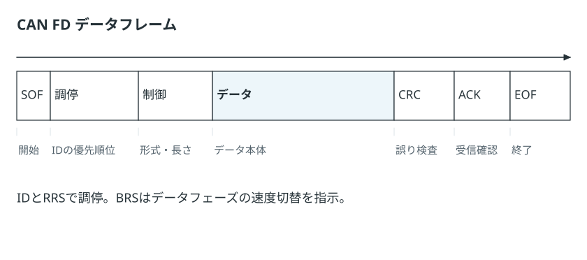

---
tags:
    - 開発資料
    - 有線通信
    - CAN FD
    - CANフレーム
    - CRC
---

# CAN / CAN FD入門 第7編
## CAN FDフレームを分解して読む

CAN FDは「データを64 byteまで増やしたCAN」と説明されることがあります。では、データ部分を長くしただけなのでしょうか。

実際には、フレーム形式を見分けるビットや途中での速度切替、送信ノードのエラー状態を示すビットもあります。長いデータを守るCRCもClassical CANとは異なります。図を見ながら順に確認していきます。

<picture><source media="(max-width: 600px)" srcset="./images/Wired_Communication/can-fd-frame-detail-mobile.svg"></picture>

## フレーム前半はClassical CANに近い

フレームはSOFから始まり、11 bitまたは29 bitのIDを送ります。IDはClassical CANと同じく、メッセージの識別と通信調停に使用されます。

標準フォーマットでは、IDの後にRRS、IDE、FDFが続きます。

| フィールド | 主な役割 |
|---|---|
| SOF | フレーム開始と同期 |
| ID | メッセージの識別と優先度 |
| RRS | Classical CANのRTR位置を置き換える固定ビット |
| IDE | 11 bit IDか29 bit IDかを識別 |
| FDF | Classical CANかCAN FDかを識別 |

CAN FDにリモートフレームはありません。Classical CANでリモート要求に使われていたRTRの位置はRRSに置き換わり、ドミナントに固定されます。

## FDFがフレーム形式を分ける

FDFはFD Format Indicatorです。

- ドミナント：Classical CANフレーム
- レセシブ：CAN FDフレーム

Classical CAN専用ノードは、FDF以降をCAN FDの規則では解釈できません。CAN FDフレームを受信すると、フォームエラーなどを検出してエラーフレームを送る場合があります。CAN FD対応ノードがClassical CANも扱えるからといって、その逆も成り立つわけではありません。

## BRSでビットレートを切り替える

BRSはBit Rate Switchです。

BRSがレセシブなら、送信側と受信側はBRSのサンプルポイント付近で高速なデータビットレートに切り替わります。CRC Delimiterのサンプルポイント付近で、公称ビットレートに戻ります。

フレーム内には、次の2種類の速度が存在します。

| フェーズ | 使用する速度 | 主な範囲 |
|---|---|---|
| アービトレーションフェーズ | 公称ビットレート | SOF、ID、調停部分、ACK、EOF |
| データフェーズ | データビットレート | ESI、DLC、Data、CRC付近 |

BRSがドミナントなら、CAN FDフレームでも速度を切り替えません。

このため、CAN FDの使い方は大きく二つに分かれます。

- データ長だけを拡張する
- データ長を拡張し、データフェーズも高速化する

## ESIは送信ノードのエラー状態を示す

ESIはError State Indicatorです。

- ドミナント：送信ノードがError Active
- レセシブ：送信ノードがError Passive

Classical CANには、送信ノードのエラー状態をフレーム内で知らせるビットはありません。CAN FDではESIを見れば送信側がError ActiveかError Passiveか分かります。ただし、ESIだけでは原因までは分かりません。エラーカウンターや診断情報も確認します。

## DLCが示す長さ

CAN FDでもDLCは4 bitです。

DLC 0～8はデータ長0～8 byteと一致します。DLC 9以降は、次のように段階的に増えます。

| DLC | データ長 |
|---:|---:|
| 0～8 | 0～8 byte |
| 9 | 12 byte |
| 10 | 16 byte |
| 11 | 20 byte |
| 12 | 24 byte |
| 13 | 32 byte |
| 14 | 48 byte |
| 15 | 64 byte |

9、10、11 byteのデータ長は定義されていません。アプリケーションから10 byte送る場合は、12 byteのフレームにして残り2 byteをどう埋めるか、通信仕様で決めておきます。

## SBCとCRC

データが長くなったため、破損を検出する仕組みも強化されています。CAN FDではデータ長に応じて17 bitまたは21 bitのCRCを使います。SBC（Stuff Bit Count）はCRC領域より前に挿入されたスタッフビット数を表し、この情報もCRCの検査対象です。

| データ長 | CRC |
|---|---|
| 0～16 byte | 17 bit CRC |
| 20～64 byte | 21 bit CRC |

CRCの仕組みをClassical CANのまま単純に延長したわけではありません。スタッフビットも含めて検査することで、長いデータ領域に対応しています。

## ACKとEOFは公称ビットレートへ戻る

データフェーズが終わると、公称ビットレートに戻ります。正常に受信したノードがACKを返し、EOFでフレームが終わります。ACKの意味はClassical CANと同じで、少なくとも一つのノードがCRCまで正常に受信したことを示します。宛先のノードがアプリケーション処理まで終えた、という確認にはなりません。

## 波形を見るときの位置関係

オシロスコープやCAN解析器で確認する場合は、次の位置が手掛かりになります。

- ID部分：公称ビットレート
- BRS付近：ビット幅が切り替わる
- Data部分：高速なデータビットレート
- CRC Delimiter付近：公称ビットレートへ戻る
- ACK：受信ノードによるドミナント応答

BRSを有効にしているのにビット幅が変わらない場合は、送信設定、コントローラのFD/BRS許可、ビットタイミングを確認します。

CAN FDフレームでは、調停時は公称ビットレートを使い、BRSを有効にした場合はデータ部分を高速に送ります。64 byteまで扱えることに加え、この速度切替もフレームの特徴です。

## 参考資料

- ベクター・ジャパン株式会社『はじめての CAN / CAN FD』
- [Bosch: CAN FD Protocol](https://www.bosch-semiconductors.com/products/ip-modules/can-protocols/can-fd/)
- [Bosch M_CAN User's Manual](https://www.bosch-semiconductors.com/media/ip_modules/pdf_2/m_can/mcan_users_manual_v331.pdf)
- [CAN in Automation: CAN FD – The basic idea](https://www.can-cia.org/can-knowledge/can-fd-the-basic-idea)

